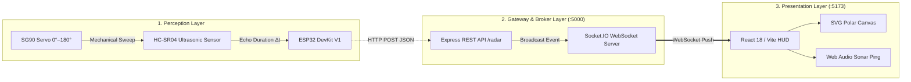

# ESP32 IoT Ultrasonic Radar Tracking Station

[](https://www.espressif.com/)
[](https://react.dev/)
[](https://nodejs.org/)
[](https://socket.io/)
[](https://www.arduino.cc/)
[](LICENSE)

A real-time spatial tracking radar system built with an **ESP32 microcontroller**, an **HC-SR04 ultrasonic distance sensor**, and an **SG90 micro servo**. The system sweeps across a 180° radial field, converts ultrasonic time-of-flight reflections into distance coordinates, and streams the telemetry in real-time over Wi-Fi to an interactive, military-HUD styled web dashboard.

---

## Key Features

- **Live Polar Radar Scope**: SVG-based semicircular radar projection featuring concentric range rings, bearing guidelines (30° intervals), and an authentic sweeping beam needle.
- **Phosphor Persistence**: Trailing sweep cone and decaying target blips simulating a cathode-ray tube (CRT) radar display.
- **Low-Latency Streaming**: Bidirectional Socket.IO WebSocket pipeline delivering edge-to-browser telemetry in under 30 ms.
- **Threat Classification & Audio Alerts**: Dynamic proximity warning banner and synthesized Web Audio API sonar pings for obstacles within 35 cm.
- **Integrated Test Bench Simulator**: Includes a hardware-free simulation engine (`npm run mock` or one-click UI toggle) for demonstrations when physical sensors or Wi-Fi networks are unavailable.
- **Theme Support**: High-contrast tactical green dark mode and clean daylight mode.

---

## System Architecture



---

## Hardware Wiring & Pin Mapping

> [!IMPORTANT]
> The HC-SR04 `ECHO` pin outputs 5V TTL logic. The ESP32 GPIO inputs are rated for 3.3V. **A voltage divider is required** on the ECHO line to prevent damaging the ESP32.

| ESP32 Terminal | Peripheral Device | Peripheral Pin | Wiring / Connection Details |
| :--- | :--- | :--- | :--- |
| **VIN / 5V** | HC-SR04 | VCC | 5V Operational Power |
| **GND** | Shared Rail | GND | Connect all GNDs together (Common Ground) |
| **GPIO 5** | HC-SR04 | TRIG | 10 µs Ultrasonic Trigger Pulse |
| **GPIO 18** | Voltage Divider | ECHO | **1 kΩ** from ECHO to GPIO 18, and **2 kΩ** from GPIO 18 to GND |
| **GPIO 19** | SG90 Servo | Signal (Orange) | 50 Hz PWM positional control |
| **GPIO 2** | Built-in LED | Anode | Status indicator: Blinking = Connecting, Solid = Online |
| **External 5V (+)**| SG90 Servo | V+ (Red) | Power from external 5V rail (avoids ESP32 brownout resets) |

---

## Project Structure

```text
esp32-ultrasonic-radar/
├── backend/
│   ├── package.json         # Express & Socket.IO dependencies
│   └── server.js            # Ingestion REST API, IP discovery & Mock simulator
├── esp32/
│   └── radar/
│       └── radar.ino        # ESP32 C++ firmware (Wi-Fi, PWM, Ultrasonic ToF)
├── frontend/
│   ├── index.html           # HTML5 entry point
│   ├── package.json         # React 18, Vite & Socket.IO-client
│   ├── vite.config.js       # Vite build configuration with React plugin
│   └── src/
│       ├── App.jsx          # Polar radar canvas, HUD metrics & audio engine
│       ├── App.css          # Military HUD CRT styles & theme tokens
│       └── main.jsx         # React DOM mounting
├── .gitignore               # Clean repo excludes (node_modules, builds, archives)
├── README.md                # Project documentation
├── start.bat                # 1-Click launcher for both backend & frontend
└── start-simulation.bat     # 1-Click launcher for simulation demo mode
```

---

## Quick Start Guide

### Method A: One-Click Launch (Windows)
- **Live Hardware Run**: Double-click [`start.bat`](start.bat) to launch the backend, frontend, and open your browser automatically.
- **Simulation Demo Run**: Double-click [`start-simulation.bat`](start-simulation.bat) to test the dashboard with simulated obstacles without hardware connected.

---

### Method B: Manual Terminal Execution

#### 1. Start the Relay Backend
```bash
cd backend
npm install
npm start
```
*(To run with simulated radar returns, run `npm run mock` instead).*  
The terminal will display your computer's local Wi-Fi IP address (e.g., `http://10.20.5.186:5000`).

#### 2. Start the Frontend Dashboard
In a second terminal:
```bash
cd frontend
npm install
npm run dev
```
Open **`http://localhost:5173`** in your browser.

#### 3. Flash the ESP32
1. Open [`esp32/radar/radar.ino`](esp32/radar/radar.ino) in the **Arduino IDE**.
2. Install the **`ESP32Servo`** library via *Sketch -> Include Library -> Manage Libraries*.
3. Update your Wi-Fi credentials and the target backend IP in the sketch:
   ```cpp
   const char* WIFI_SSID     = "YOUR_WIFI_NAME";
   const char* WIFI_PASSWORD = "YOUR_WIFI_PASSWORD";
   const char* SERVER_URL    = "http://YOUR_LAPTOP_IP:5000/radar";
   ```
4. Select your ESP32 board and COM port, then click **Upload**.
5. Open the **Serial Monitor** at **115200 baud** to view real-time distance measurements and packet transmission status.

---

## Troubleshooting & Engineering Notes

- **ESP32 Brownout / Servo Jitter**: The SG90 servo motor draws inductive inrush current spikes (up to 800 mA) when reversing direction. Power the servo from an external regulated 5V supply or battery pack, and ensure common ground with the ESP32.
- **`POST failed: connection refused`**: Ensure your laptop and ESP32 are connected to the exact same Wi-Fi network (or personal hotspot). Campus/university networks often enforce **AP Client Isolation**, which blocks direct peer-to-peer communication. Using a mobile hotspot resolves this.
- **Link Offline on Dashboard**: Verify port `5000` is allowed through your Windows Firewall. Click the connection pill in the dashboard header to verify or edit the backend URL.

---

## Team Contributions

- **Pulin**: Hardware circuit assembly, sensor wiring, 5V-to-3.3V voltage divider safety design, and acoustic calibration.
- **Vedant**: Mechanical servo mounting, external 5V power bus, ESP32 Wi-Fi firmware, and Node.js gateway ingestion.
- **Meetraj**: Socket.IO real-time WebSocket pipeline, React SVG radar HUD, polar coordinate projection mathematics, and system testing.

---

## License

This project is open-source and available under the [MIT License](LICENSE).
